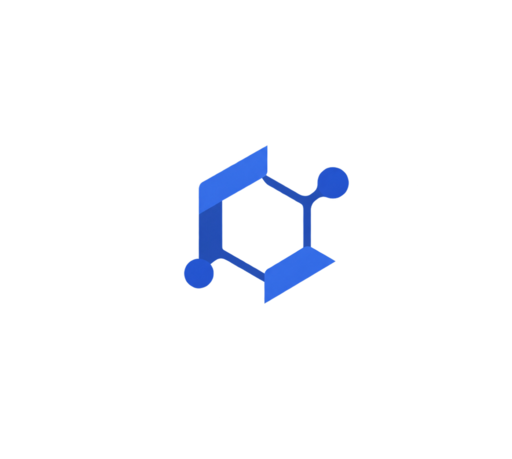

<p align="center">
  
</p>

<h1 align="center">Hydrogen</h1>

<p align="center">
  Небольшой статически типизированный язык с C#-подобным синтаксисом и собственным характером.
</p>

<p align="center">
  <a href="https://github.com/rusward/hydrogen/actions/workflows/ci.yml">
    
  </a>
  <a href="LICENSE">
    
  </a>
  
  
</p>

Hydrogen (`hydrogenc`) компилирует `.hy` в C99 и собирает нативный бинарник через `gcc`.
Функции объявляются через `func ... -> тип`, структуры собираются литералами без `new`,
а циклы бывают трёх видов — `while`, `for` и `loop`.

> **Статус:** ранняя версия 0.2.0. Язык и синтаксис ещё могут меняться.

## Возможности

- строгие типы `int` (64 бита), `double`, `bool`, `string` без неявных преобразований;
- функции, параметры, возвращаемые значения, рекурсия и вызовы вперёд;
- структуры с полями, литералы `Point { x = 1, y = 2 }`, доступ и присваивание полей;
- передача и возврат структур по значению;
- `if / else if / else`, `while`, `for`, `loop`, `break`, `continue`;
- единственная встроенная функция `log(...)` с переменным числом аргументов;
- блочные области видимости и подробная диагностика с позицией в `.hy`;
- компилятор на Python без внешних зависимостей.

## Пример

```csharp
struct Point {
    int x;
    int y;
}

func distanceSquared(Point a, Point b) -> int {
    int dx = a.x - b.x;
    int dy = a.y - b.y;
    return dx * dx + dy * dy;
}

Point a = Point { x = 1, y = 2 };
Point b = Point { x = 4, y = 6 };

log("distance^2 =", distanceSquared(a, b));

for (int i = 1; i <= 3; i = i + 1) {
    log("step", i);
}
```

```
$ hydrogenc build example.hy -o example
$ ./example
distance^2 = 25
step 1
step 2
step 3
```

## Требования

- Python 3.10+
- C99-компилятор (`gcc` по умолчанию)

Проект разрабатывается и тестируется на Linux x86-64.

## Установка

```sh
git clone https://github.com/rusward/hydrogen.git
cd hydrogen

python3 -m pip install -e .
hydrogenc --version
```

Можно обойтись без установки — в корне лежит launcher:

```sh
./hydrogenc --version
./hydrogenc build examples/hello.hy -o hello
./hello
```

## CLI

```
hydrogenc build <file.hy> [-o out] [--emit-c PATH] [--keep-c] [--static] [--cc gcc]
hydrogenc check <file.hy>
hydrogenc emit-c <file.hy> [-o out.c]
hydrogenc --version
```

- `build` собирает нативный бинарник;
- `check` проверяет синтаксис и типы без вызова C-компилятора;
- `emit-c` печатает сгенерированный C;
- `--emit-c PATH` сохраняет C-код при сборке;
- `--keep-c` оставляет временный C-файл;
- `--cc NAME` выбирает C-компилятор.

Коды возврата: `0` — успех, `1` — ошибка компиляции/типов/рантайма, `2` — ошибка
использования CLI, `3` — сбой C-компилятора.

## Тесты

```sh
make test
```

End-to-end тесты собирают настоящие бинарники и пропускаются, если `gcc` не найден.

## Структура проекта

```
src/hydrogenc/    компилятор (лексер, парсер, проверка типов, кодоген)
examples/         примеры программ и примеры ошибок
tests/            unittest-набор
docs/syntax.md    практическое руководство по синтаксису (на русском)
SPEC.md           формальная грамматика и семантика
logo/             ассеты логотипа
```

## Документация

- [docs/syntax.md](docs/syntax.md) — синтаксис и примеры на русском.
- [SPEC.md](SPEC.md) — грамматика EBNF, типы, семантика и диагностика.
- [CHANGELOG.md](CHANGELOG.md) — история изменений.
- [CONTRIBUTING.md](CONTRIBUTING.md) — как собрать, тестировать и присылать изменения.

## Планы

- массивы и `foreach`;
- `switch`;
- строковые и математические функции в стандартной библиотеке;
- модули/импорты;
- публикация пакета и релизные бинарники.

## Лицензия

[MIT](LICENSE) © Hydrogen contributors.
